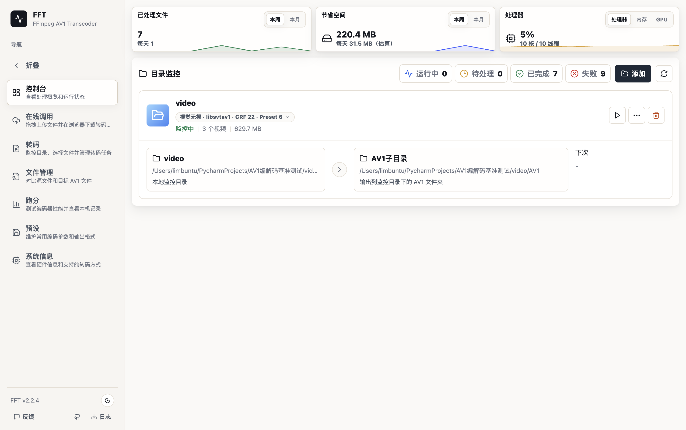
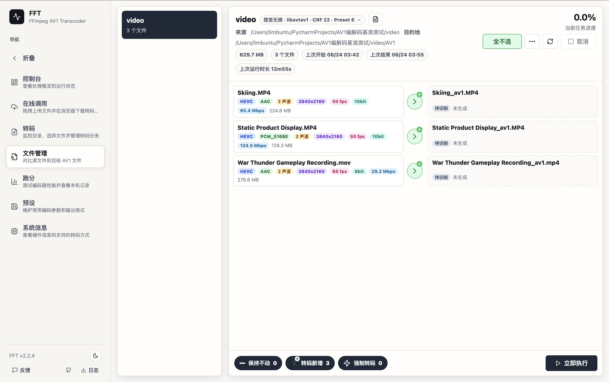
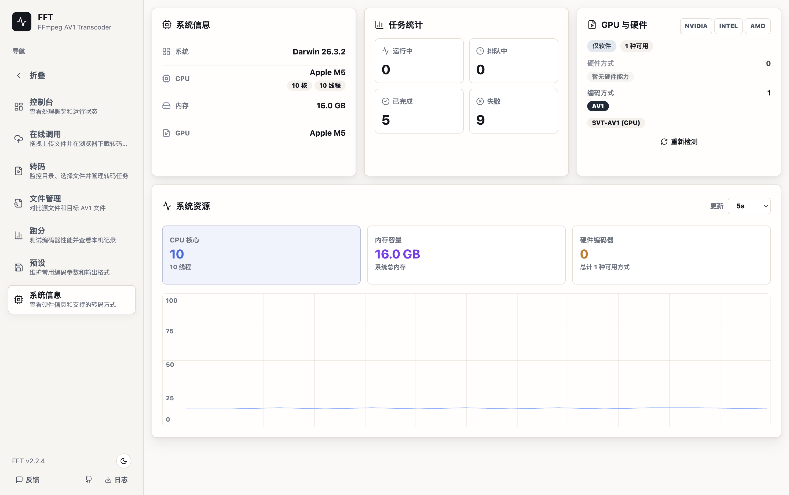

# FFT — FFmpeg AV1 Transcoder

FFT 是一个面向 AV1 转码工作流的本地 Web 工具，制作这个软件的目的，是在硬盘价格上涨的当下，帮助大家通过更高效的视频压缩节约硬盘空间。它把目录监控、文件对比、在线调用、预设管理、硬件能力探测、跑分记录和报告导出放在同一个界面里，适合在个人电脑、工作站或家庭局域网内批量管理视频转码任务。

后端使用 Go、Gin、SQLite，前端使用 React、TypeScript、Tailwind CSS。核心转码由本机或容器内的 FFmpeg / ffprobe 完成。

## 功能特点

- 目录监控：按任务管理源目录和输出目录，支持手动执行、自动扫描、新文件自动转码和任务报告。
- 文件管理：左右对比源文件与 AV1 输出文件，按“保持不动 / 转码新增 / 强制转码”过滤并批量选择。
- 在线调用：拖拽上传视频，选择本机可用预设后转码，完成后直接从浏览器下载结果。
- 预设系统：内置 CPU、NVIDIA、Intel、AMD 预设分类，自动隐藏当前机器不可用的编码方式。
- AV1 工作流：支持 SVT-AV1、libaom-av1、rav1e、Intel QSV、NVIDIA NVENC、AMD AMF 等编码器。
- 硬件探测：展示 CPU、内存、GPU、硬件编码器、FFmpeg 编码器能力和 GPU 负载。
- 实时进度：任务列表、控制台、文件管理页联动展示转码进度和单文件状态。
- 跑分与排行：记录本机编码器测试结果，并按编码器类别展示排行榜。
- 报告导出：任务完成后可生成 PDF 报告，便于归档或对比。
- 本地持久化：SQLite 保存目录监控、预设、任务、跑分和历史状态，后端重启不会清空控制台数据。
- 局域网访问：默认监听 `0.0.0.0:8166`，同一局域网设备可访问服务地址。

## 界面预览

### 控制台



### 文件管理



### 系统信息



## 快速开始

### 下载发布包

GitHub Release 会提供这些产物：

| 产物 | 说明 |
| --- | --- |
| `FFT-windows-x64-full.zip` | Windows 完整包，内置 FFmpeg / ffprobe，适合直接运行 |
| `FFT-windows-x64-lite.zip` | Windows 精简包，需要系统 PATH 中已有 FFmpeg / ffprobe |
| `FFT-macos-arm64.tar.gz` | macOS Apple Silicon 版本 |
| `FFT-macos-x64.tar.gz` | macOS Intel 版本 |

桌面发布包默认会在启动后打开浏览器。Windows 如果首次运行被系统拦截，请允许本程序访问本机网络；局域网访问还需要防火墙放行 8166 端口。

### Docker

保存为 `docker-compose.yml`：

```yaml
services:
  fft-go:
    container_name: fft-go
    image: ghcr.io/limbuntu/fft-go:latest
    # NVIDIA GPU:
    # image: ghcr.io/limbuntu/fft-go:gpu
    # Intel GPU:
    # image: ghcr.io/limbuntu/fft-go:intel
    restart: unless-stopped
    ports:
      - "8166:8166"
    volumes:
      - /your/media/path:/data
      - ./fft-go/output:/output
      - ./fft-go/data:/app/data
    environment:
      - FFT_HOST=0.0.0.0
      - FFT_PORT=8166
      - FFT_DATA_DIR=/app/data
      - FFT_CACHE_DIR=/app/data/cache
      - FFT_DB=/app/data/fft.db
      - FFT_LOG_FILE=/app/data/logs/fft.log
    networks:
      - fft-network

    # Intel GPU:
    # devices:
    #   - /dev/dri:/dev/dri

    # NVIDIA GPU:
    # gpus: all

networks:
  fft-network:
    driver: bridge
```

启动：

```bash
docker compose up -d
open http://localhost:8166
```

如果需要硬件加速镜像，可以把镜像标签换成 `gpu` 或 `intel`，并按注释开启对应设备配置。是否能启用硬件编码取决于宿主机显卡、驱动、容器运行时和 FFmpeg 能力。

NVIDIA 示例：

```yaml
image: ghcr.io/limbuntu/fft-go:gpu
```

Intel 示例：

```yaml
image: ghcr.io/limbuntu/fft-go:intel
```

### 开发模式

需要本机准备 Go、Node.js、FFmpeg 和 ffprobe。

```bash
npm install --prefix frontend
npm run server
npm run dev
```

后端默认监听 `http://0.0.0.0:8166`，前端开发服务器默认监听 `http://localhost:5173/`。

## 项目结构

FFT 由本地 Web 界面、后端服务、SQLite 数据库和 FFmpeg 转码执行器组成。前端负责目录监控、文件管理、在线调用、系统信息、预设和报告等页面；后端负责硬件探测、任务调度、进度推送、历史记录和报告生成。

运行时数据默认写在项目根目录或 `FFT_DATA_DIR` 指定目录中：

```text
fft.db          # SQLite 数据库
logs/fft.log    # 运行日志
cache/          # 在线调用上传与输出缓存
```

## 环境指标

| 项目 | 建议 |
| --- | --- |
| CPU 转码 | 现代多核 CPU，SVT-AV1 更适合常规批量转码 |
| NVIDIA | 需要支持 AV1 NVENC 的显卡、驱动与 FFmpeg 编码器 |
| Intel | 需要支持 AV1 QSV 的核显或独显，以及可用的 VA-API / QSV 运行时 |
| AMD | 需要支持 AV1 AMF 的显卡、驱动与 FFmpeg 编码器 |
| 内存 | 建议 8 GB 起，4K 或批量任务建议更高 |
| 磁盘 | 输出目录需要预留源文件大小的额外空间 |

FFT 会根据 `ffmpeg -encoders` 和轻量探测结果决定哪些预设可用。某个硬件预设不显示，通常表示当前 FFmpeg、驱动或硬件不支持对应编码器。

## 环境变量

| 变量 | 默认值 | 说明 |
| --- | --- | --- |
| `FFT_HOST` | `0.0.0.0` | 后端监听地址 |
| `FFT_PORT` | `8166` | 后端监听端口 |
| `FFT_DATA_DIR` | 当前工作目录 | SQLite、日志、缓存等运行数据目录 |
| `FFT_CACHE_DIR` | `$FFT_DATA_DIR/cache` | 在线调用上传文件和转码输出缓存目录 |
| `FFT_DB` | `$FFT_DATA_DIR/fft.db` | SQLite 数据库路径 |
| `FFT_STATIC_DIR` | `frontend/dist` 或 `static` | 前端静态资源目录 |
| `FFT_LOG_FILE` | `$FFT_DATA_DIR/logs/fft.log` | 日志文件路径 |
| `FFT_OPEN_BROWSER` | `false` | 启动后是否自动打开浏览器 |

发布包会默认打开浏览器；Docker 运行时默认不自动打开浏览器。

## 技术栈

- 后端：Go、Gin、SQLite、WebSocket
- 前端：React 18、TypeScript、Vite、Tailwind CSS、lucide-react
- 转码：FFmpeg、ffprobe、SVT-AV1、libaom-av1、rav1e、NVENC、QSV、AMF
- 部署：桌面发布包、Docker、Docker Compose

## 鸣谢

- [FFmpeg](https://ffmpeg.org/)：提供核心音视频处理能力。
- [ChanningHe/ffforge](https://github.com/ChanningHe/ffforge)：前端设计与交互参考。

## 转码效果示例

以 iPhone 16 Pro 拍摄的 4K 60fps HDR 视频为例（HEVC → AV1，CRF 28，Preset 8）：

| 项目         | IMG_2634.MOV (原始)                   | IMG_2634_av1.mp4 (转码后)             |
|--------------|---------------------------------------|---------------------------------------|
| 封装格式     | QuickTime MOV                         | MP4 (ISOM)                            |
| 文件大小     | 44 MB                                 | 13 MB                                 |
| 总码率       | 53.4 Mbps                             | 15.3 Mbps                             |
| 视频编码     | H.265/HEVC (Main 10)                  | AV1 (Main, libsvtav1)                 |
| 视频码率     | 52.7 Mbps                             | 15.1 Mbps                             |
| 分辨率       | 3840x2160 (含旋转-90°)                | 2160x3840 (已旋转写入)                |
| 帧率         | 60fps                                 | 60fps                                 |
| 像素格式     | yuv420p10le (10bit)                   | yuv420p10le (10bit)                   |
| 色彩空间     | BT.2020 / HLG                         | BT.2020 / HLG                         |
| B帧          | 有 (has_b_frames=2)                   | 无 (has_b_frames=0)                   |
| 音频编码     | AAC LC, 立体声, 48kHz                 | AAC LC, 立体声, 48kHz (一致)          |
| 额外音轨     | 4声道 Apple Spatial Audio (apac)      | 无 (丢失)                             |
| Dolby Vision | 有 (Profile 8, 兼容HLG)              | 无 (丢失)                             |
| 元数据轨道   | 6条 (陀螺仪、GPS等)                   | 无 (丢失)                             |
| 设备信息     | iPhone 16 Pro, iOS 26.3               | 无 (丢失)                             |

> **注意：** AV1 转码后会丢失部分元数据，请根据需要自行修改 ffmpeg 预设

## 路线图

- [ ] 集成视频质量评估指标（VMAF / SSIM / PSNR），转码完成后自动进行画质对比分析
- [x] 任务列表增加详细日志输出，支持查看每个任务的完整 FFmpeg 执行日志
- [ ] 新增音频转码选项，支持独立配置音频编码器、码率、采样率等参数
- [x] 前端界面视觉重构，优化交互体验与整体布局设计
